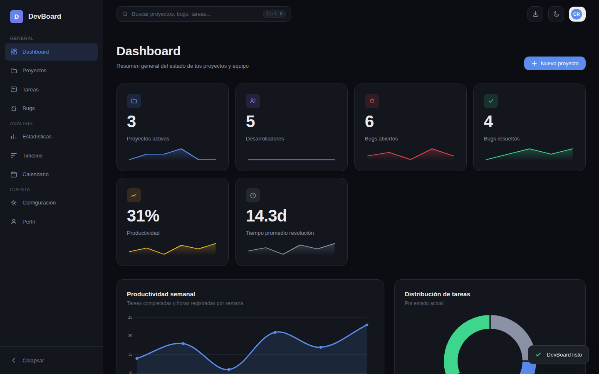

# DevBoard — Dashboard de Analítica para Desarrolladores

Aplicación tipo SaaS para administrar proyectos de software, tareas y bugs, con visualización de métricas de productividad del equipo. Inspirada en GitHub Insights, Vercel Dashboard, Stripe Dashboard, Linear y Supabase.

Construida en **JavaScript vanilla (ES Modules)**, sin frameworks ni build step. Los datos viven en `localStorage`, con una semilla inicial cargada desde un JSON.



## ✨ Funcionalidades

- **Dashboard** con cards de métricas (proyectos activos, desarrolladores, bugs abiertos/resueltos, productividad, tiempo promedio de resolución), cada una con su propio sparkline.
- **Gestión de proyectos**: CRUD completo (nombre, cliente, fechas, estado, prioridad, color, avance).
- **Gestión de tareas**: CRUD con responsable, horas estimadas vs. reales, estado y prioridad.
- **Gestión de bugs**: registro de incidencias por proyecto, con prioridad y estado.
- **Estadísticas**: 6 gráficos con Chart.js (productividad semanal, horas trabajadas, bugs por proyecto, proyectos por estado, tiempo de resolución, distribución de tareas).
- **Calendario** mensual con entregas, reuniones y fechas límite.
- **Timeline** tipo Gantt simplificado con el avance de cada proyecto.
- **Filtros y buscador** en cada vista (por cliente, proyecto, estado, prioridad).
- **Command palette** (`Ctrl/Cmd + K`) con búsqueda global, estilo VS Code.
- **Modo oscuro/claro** con transición animada.
- **Exportación** a CSV y JSON, por vista o de todos los datos.
- **Notificaciones** (toasts) en cada acción relevante.
- **Sidebar colapsable** y diseño responsive (mobile-first en breakpoints clave).
- **Skeleton loaders** durante la carga inicial de datos.
- **Configuración**: tema, idioma (visual) y tamaño de fuente.
- **Perfil** del usuario con avatar, nombre, cargo y productividad.

## 🛠️ Stack

- HTML5 + CSS3 (variables CSS, Grid, Flexbox, animaciones)
- JavaScript ES2022+ (clases, módulos ES6, `EventTarget` para el patrón observer)
- [Chart.js](https://www.chartjs.org/) v4 (incluido localmente en `assets/vendor`, sin dependencia de CDN)
- `localStorage` como capa de persistencia
- Tipografías: Space Grotesk (display), Inter (UI), JetBrains Mono (datos)

No requiere `npm install` ni build step: es HTML/CSS/JS puro.

## 📁 Estructura del proyecto

```
devboard/
├── index.html
├── css/
│   ├── tokens.css        # Variables de diseño (color, tipografía, espaciado)
│   ├── base.css          # Reset y estilos base
│   ├── layout.css        # Sidebar, topbar, grids
│   ├── components.css    # Cards, tablas, modales, calendario, etc.
│   └── animations.css
├── data/
│   └── seed.json         # Datos iniciales (proyectos, tareas, bugs, etc.)
├── js/
│   ├── app.js             # Punto de entrada y navegación
│   ├── models/            # Clases: Project, Task, Bug, Developer
│   ├── services/          # storage.js, store.js (estado central), export.js
│   ├── components/        # Vistas y widgets (dashboard, charts, modal, etc.)
│   └── utils/             # format.js, sortSearch.js, dom.js
└── assets/
    └── vendor/
        └── chart.umd.min.js
```

## 🚀 Cómo correrlo

Como usa ES Modules (`import`/`export`), necesita servirse vía HTTP (no funciona abriendo el `.html` directo con `file://`).

**Opción 1 — Python:**
```bash
cd devboard
python3 -m http.server 8080
```
Luego abre `http://localhost:8080`.

**Opción 2 — Node (npx, sin instalar nada global):**
```bash
cd devboard
npx serve .
```

**Opción 3 — Extensión "Live Server" de VS Code.**

## 🔄 Reiniciar los datos

Los datos se guardan en `localStorage` bajo claves con prefijo `devboard:v1:`. Para reiniciar a los datos de ejemplo:

```js
// En la consola del navegador
Object.keys(localStorage)
  .filter(k => k.startsWith('devboard:v1:'))
  .forEach(k => localStorage.removeItem(k));
location.reload();
```

## 🧠 Decisiones de arquitectura

- **Store central con patrón Observer**: `store.js` extiende `EventTarget` y emite eventos (`projects:changed`, `tasks:changed`, etc.) cuando algo cambia, para que las vistas se re-rendericen reactivamente sin acoplarse entre sí.
- **Modelos como clases**: `Project`, `Task`, `Bug` y `Developer` validan sus propios datos y exponen getters derivados (ej. `project.isOverdue`, `task.hoursVariance`).
- **Módulos ES6** separados por responsabilidad (modelos / servicios / componentes / utilidades) en vez de un único archivo.
- **Chart.js vendored localmente** en `assets/vendor` para que el proyecto funcione sin conexión a un CDN externo.

---

Proyecto desarrollado por **Matías Torres Sandoval** como pieza de portafolio — Ingeniero Civil Informático (UNAB).
